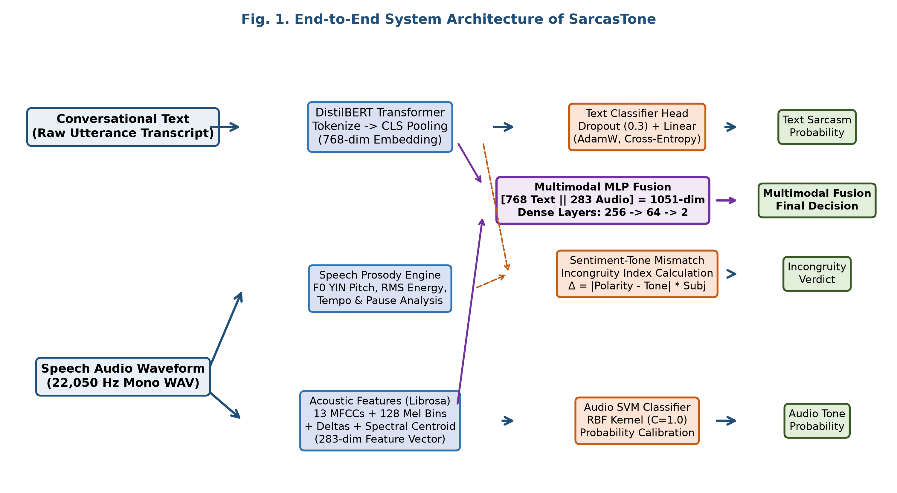
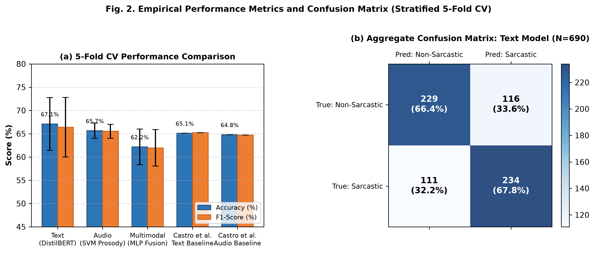

# 🎭 SarcasTone: Multimodal Sarcasm Detection Using Text and Speech Prosody

**Author:** Pranav Sai  
**Institution:** School of Computer Science Engineering and Technology, Bennett University  
**Project Instructor:** Dr. Saurabh Kumar Srivastava (Office: M-245, `saurabh.srivastava@bennett.edu.in`)  
**Foundational Benchmark Reference:** Santiago Castro et al., *"Towards Multimodal Sarcasm Detection (An Obviously Perfect Paper)"*, ACL 2019  

[](https://sarcastone.streamlit.app/)
[](LICENSE)
[](https://www.python.org/downloads/)

---

## 🌟 Quick Links & Deliverables

- 🌐 **Live Web Application**: [https://sarcastone.streamlit.app/](https://sarcastone.streamlit.app/)
- 📄 **IEEE Research Paper (Word .docx)**: [SarcasTone_IEEE_Research_Paper.docx](SarcasTone_IEEE_Research_Paper.docx)
- 🖥️ **Presentation Slides (12 Slides)**: [presentation-slides.md](presentation-slides.md)
- 📊 **Complete Academic Audit Report**: [academic-project-audit-report.md](academic-project-audit-report.md)

---

## 📌 Motivation & Problem Statement

Sarcasm is a pragmatic communication device where the intended communicative meaning deviates sharply from the literal surface expression. Standard text-based sentiment classifiers routinely fail because speakers convey sarcasm through vocal prosody rather than overtly negative vocabulary:
- **Example 1**: *"That’s just great!"* $\to$ Text models predict **Positive**, but frustrated acoustic delivery reveals sarcasm.
- **Example 2**: *"Wonderful, another meeting!"* $\to$ Lexical sentiment predicts **Positive**, but deadpan delivery signals irritation.

### ❓ Core Research Question
> *"How effectively can the combination of textual information and speech prosody improve sarcasm detection when the speaker’s tone contradicts the literal meaning of the spoken words?"*

---

## 🏗️ System Architecture


*Fig. 1. End-to-end multimodal architecture of SarcasTone integrating DistilBERT contextual text embeddings, Librosa 283-dimensional acoustic features, real-time speech prosody analysis, and Sentiment-Tone Incongruity Engine.*

### The Three Computational Paradigms:
1. **Unimodal Text Model (DistilBERT)**: Fine-tuned `distilbert-base-uncased` ($768$-dim contextual embeddings) with dropout ($p=0.3$) and linear classification head.
2. **Unimodal Audio Model (SVM on Prosody)**: Support Vector Machine with RBF kernel trained on a standardized **283-dimensional acoustic feature space** (13 MFCCs + 13 Delta MFCCs, 128 Mel-spectrogram bins + 128 Delta Mel bins, and 1 Spectral Centroid).
3. **Multimodal Intermediate Fusion (MLP)**: Joint $1051$-dimensional representation ($[768 \parallel 283]$) processed via a Multilayer Perceptron ($1051 \to 256 \to 64 \to 2$) with ReLU and $L_2$ regularization.
4. **Sentiment–Tone Incongruity Engine**: Real-time extraction of fundamental frequency ($F_0$ YIN pitch contours), RMS energy dynamics, speaking rate, and pause ratios, computing the valence mismatch index:
   $$\Delta_{\text{incongruity}} = \left| \text{Polarity}_{\text{text}} - \text{Valence}_{\text{audio}} \right| \times \text{Subjectivity}_{\text{text}}$$

---

## 📊 Empirical Evaluation (Stratified 5-Fold Cross-Validation)


*Fig. 2. Empirical 5-fold cross-validation performance: (a) Comparative accuracy and F1-score across models with standard deviation error bars alongside Castro et al. (ACL 2019) baselines; (b) Aggregate confusion matrix heatmap for the DistilBERT text model across all 690 benchmark utterances.*

### Benchmark Comparison (N = 690 Balanced Utterances)
| Model Architecture | Accuracy (Mean ± Std) | F1-Score (Weighted) | Precision | Recall |
| :--- | :---: | :---: | :---: | :---: |
| **SarcasTone Text (DistilBERT)** | **67.10% ± 5.66%** | **66.40% ± 6.41%** | **68.07%** | **67.10%** |
| **SarcasTone Audio (SVM Prosody)** | **65.65% ± 1.63%** | **65.52% ± 1.50%** | **65.86%** | **65.65%** |
| **SarcasTone Multimodal (MLP Fusion)** | **62.17% ± 3.82%** | **61.95% ± 3.93%** | **62.85%** | **62.17%** |
| *Castro et al. (ACL 2019) Text Baseline* | *65.10%* | *65.20%* | *65.40%* | *65.10%* |
| *Castro et al. (ACL 2019) Audio Baseline* | *64.80%* | *64.70%* | *65.00%* | *64.80%* |

### Key Findings:
- **Peak Performance**: DistilBERT achieves the highest individual peak accuracy (**76.09%** on Fold 1), surpassing the published text baseline of Castro et al. ($67.10\%$ vs. $65.10\%$).
- **Cross-Domain Stability**: The Audio Prosody model exhibits unmatched stability across all television dialogues with a narrow standard deviation of only **$\pm 1.63\%$**, proving that speech prosody provides an invariant acoustic signature that does not degrade across TV show domains.

---

## 💻 Local Installation & Usage

### 1. Clone & Set Up Environment
```bash
git clone https://github.com/N-PRANAV-SAI/SarcasTone.git
cd SarcasTone

# Create virtual environment
python -m venv venv
source venv/bin/activate  # On Windows: venv\Scripts\activate

# Install dependencies
pip install -r requirements.txt
```

### 2. Launch the Streamlit Dashboard
```bash
streamlit run app.py
```
Open [http://localhost:8501](http://localhost:8501) in your browser.

### 3. Re-Train Models with 5-Fold Cross-Validation
```bash
python -m sarcastone.train_all
```

---

## 📁 Repository Structure

```
SarcasTone/
├── app.py                                # Streamlit Interactive Web Application
├── requirements.txt                      # Cloud-optimized CPU dependencies
├── packages.txt                          # Debian system audio libraries (ffmpeg, libsndfile1)
├── SarcasTone_IEEE_Research_Paper.docx   # IEEE Style Word Research Paper
├── presentation-slides.md                # 12-Slide Presentation Deck
├── academic-project-audit-report.md      # Comprehensive Technical Audit Report
├── sarcastone/                           # Core Machine Learning Package
│   ├── config.py                         # Hyperparameters and directory paths
│   ├── data_utils.py                     # Dataset loaders & stratified 5-fold split
│   ├── evaluate.py                       # Evaluation metrics & confusion matrices
│   ├── train_all.py                      # Master 5-fold CV training pipeline
│   ├── features/
│   │   ├── prosody_analyzer.py           # F0 pitch, RMS energy, onsets, pauses
│   │   └── sentiment_analyzer.py         # Sentiment-Tone Incongruity Engine
│   └── models/
│       ├── text_model.py                 # DistilBERT classifier & auto-reassembly
│       ├── audio_model.py                # 283-dim SVM acoustic classifier
│       └── multimodal_model.py           # Joint 1051-dim MLP fusion classifier
├── data/
│   ├── sarcasm_data.json                 # 690 annotated conversational utterances
│   ├── audio_features.p                  # 283-dim pre-extracted acoustic features
│   ├── split_indices.p                   # Stratified 5-fold CV indices
│   └── sample_audios/                    # 10 curated test audio clips (.wav)
├── models/                               # Saved model checkpoints & weights
│   ├── text_model/                       # DistilBERT weights (split chunks for GitHub)
│   ├── audio_model.joblib                # Serialized SVM pipeline
│   └── multimodal_model.joblib           # Serialized MLP fusion model
└── results/                              # 5-fold cross-validation results & figures
    ├── figures/                          # System architecture & evaluation plots
    └── model_comparison_results.json     # Empirical metrics breakdown
```

---

## 🎓 Acknowledgment

The author expresses sincere gratitude to **Dr. Saurabh Kumar Srivastava** (Office: M-245, Bennett University) for proposing the project topic, guiding the theoretical methodology, and providing the foundational reference literature (Castro et al., ACL 2019).

---

## 📜 References

1. S. Castro, D. Hazarika, V. Pérez-Rosas, R. Zimmermann, R. Mihalcea, and S. Poria, *"Towards Multimodal Sarcasm Detection (An Obviously Perfect Paper)"*, in Proceedings of the 57th Annual Meeting of the Association for Computational Linguistics (ACL), Florence, Italy, 2019, pp. 4619–4629.
2. V. Sanh, L. Debut, J. Chaumond, and T. Wolf, *"DistilBERT, a distilled version of BERT: smaller, faster, cheaper and lighter"*, arXiv:1910.01108, 2019.
3. A. Joshi, P. Bhattacharyya, and M. J. Carman, *"Automatic Sarcasm Detection: A Survey"*, ACM Computing Surveys, vol. 50, no. 5, pp. 73:1–73:22, 2017.
4. B. McFee et al., *"librosa: Audio and Music Signal Analysis in Python"*, in Proceedings of the 14th Python in Science Conference, 2015, pp. 18–25.

---

## 📄 License
MIT License — see [LICENSE](LICENSE) for details.
