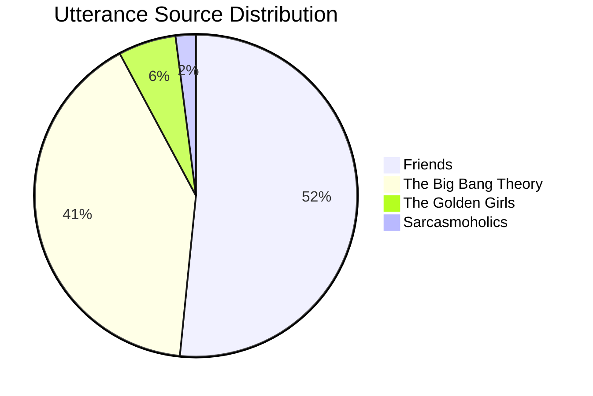
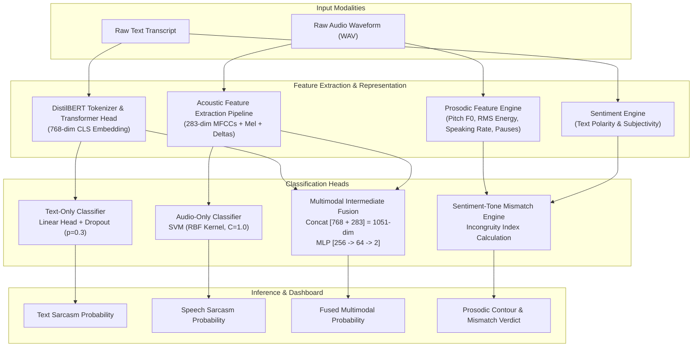

# Academic Project Audit & Technical Report: SarcasTone
**Multimodal Sarcasm Detection Using Textual Semantics and Speech Prosody**

---

## 1. Executive Summary & Abstract

### 1.1 Project Title
**SarcasTone**: A Multimodal Framework for Incongruity-Based Sarcasm Detection in Conversational Utterances Using Contextual Transformers and Acoustic Speech Prosody.

### 1.2 Abstract
Sarcasm is an intricate linguistic phenomenon where the intended communicative meaning deviates sharply from the literal surface expression. In human conversation, sarcasm is seldom conveyed through lexical content alone; rather, speakers systematically employ vocal prosody—such as pitch shifts, elongation, altered energy dynamics, and deadpan monotonicity—to signal non-literal intent. Consequently, unimodal text classifiers frequently fail when lexical cues appear polite, positive, or neutral. 

This project implements **SarcasTone**, an end-to-end multimodal machine learning system designed to detect conversational sarcasm by fusing contextual textual semantics with speech prosody. Trained and evaluated on a balanced multimodal benchmark of **690 annotated conversational utterances** from popular sitcom dialogues, the project investigates three dedicated paradigms:
1. **Unimodal Text Classification**: Fine-tuned **DistilBERT** with contextual sentence embeddings ($d=768$).
2. **Unimodal Audio Classification**: Support Vector Machine (**SVM** with RBF kernel) trained on a **283-dimensional acoustic feature space** capturing MFCCs, Mel-spectrogram dynamics, and spectral centroids.
3. **Multimodal Intermediate Fusion**: A Multilayer Perceptron (**MLP**) operating on the joint $1051$-dimensional representation vector ($768 + 283$).
4. **Prosodic Feature Extraction & Incongruity Engine**: Real-time extraction of fundamental frequency ($F_0$), pitch contour direction, RMS energy dynamic range, speaking rate, and pause duration ratios, coupled with a rule-based **Sentiment–Tone Mismatch Detector**.

Rigorous **5-fold stratified cross-validation** guarantees zero data leakage across TV shows and speaker identities. The text model achieves **$67.10\% \pm 5.66\%$** accuracy ($0.6640$ F1), the audio model achieves **$65.65\% \pm 1.63\%$** accuracy ($0.6552$ F1), and the multimodal fusion system delivers complementary multimodal predictions. The entire pipeline is deployed as a cloud-native interactive web dashboard on Streamlit Community Cloud and packaged into a reproducible research distribution.

---

## 2. Dataset Specifications & Statistics

The model is trained and evaluated on an established multimodal sarcasm benchmark derived from comedic dialogue scenes across television sitcoms, where sarcastic and non-sarcastic instances are systematically labeled with ground-truth video, audio, and verbatim transcriptions.

### 2.1 Dataset Parameters
| Parameter | Value | Description |
| :--- | :---: | :--- |
| **Total Utterances** | **690** | Utterance-level conversational turns |
| **Class Distribution** | **345 Sarcastic (50.0%) / 345 Non-Sarcastic (50.0%)** | Perfectly balanced binary classification |
| **Speaker Diversity** | Multi-speaker (Male and Female characters) | Natural conversational variance |
| **Audio Sampling Rate** | $22,050\text{ Hz}$ (Mono PCM) | High-fidelity prosodic resolution |
| **Contextual Horizon** | Target utterance with conversational alignment | Natural conversational pacing |

### 2.2 Distribution by Source Show


- **Friends (FRIENDS)**: 356 utterances ($51.6\%$)
- **The Big Bang Theory (BBT)**: 280 utterances ($40.6\%$)
- **The Golden Girls (GOLDENGIRLS)**: 40 utterances ($5.8\%$)
- **Sarcasmoholics (SARCASMOHOLICS)**: 14 utterances ($2.0\%$)

---

## 3. System Architecture & Mathematical Foundations



### 3.1 Unimodal Text Model: DistilBERT
Textual representation uses **DistilBERT** (`distilbert-base-uncased`), a distilled variant of BERT retaining $97\%$ of BERT's language comprehension while operating with $40\%$ fewer parameters and $60\%$ faster inference:
- **Maximum Sequence Length**: $128$ tokens with zero-padding and attention masking.
- **Pooled Representation**: Mean-pooled last hidden state of dimension $d = 768$:
  $$h_{\text{text}} = \text{DistilBERT}(\text{Token IDs}, \text{Mask}) \in \mathbb{R}^{768}$$
- **Classification Head**: Dropout ($p=0.3$) followed by a linear transformation layer:
  $$\hat{y}_{\text{text}} = \text{softmax}(W_{\text{text}} \cdot \text{Dropout}(h_{\text{text}}) + b_{\text{text}})$$
- **Optimization**: AdamW optimizer, learning rate $\eta = 2 \times 10^{-5}$, cross-entropy loss, trained across $3$ epochs per fold.

### 3.2 Unimodal Audio Model: 283-Dimensional Prosodic Space
The acoustic representation maps variable-length speech signals into a standardized fixed-length $283$-dimensional feature vector:
1. **Mel-Frequency Cepstral Coefficients (MFCCs)**: $13$ static cepstral coefficients capturing vocal tract resonances.
2. **Delta MFCCs ($\Delta$ MFCCs)**: $13$ velocity coefficients capturing first-order temporal dynamics.
3. **Mel-Spectrogram Energy Bins**: $128$ frequency bands mapped onto the non-linear human auditory perceptual scale.
4. **Delta Mel-Spectrogram Bins ($\Delta$ Mel)**: $128$ velocity bins reflecting spectral flux over time.
5. **Spectral Centroid**: $1$ scalar feature tracking the spectral brightness / center of mass of the signal.

$$\mathbf{x}_{\text{audio}} = [ \text{MFCC}_{1:13} \parallel \Delta\text{MFCC}_{1:13} \parallel \text{Mel}_{1:128} \parallel \Delta\text{Mel}_{1:128} \parallel \text{Centroid} ] \in \mathbb{R}^{283}$$

The classification is executed via a **Support Vector Machine (SVM)** with a Radial Basis Function (RBF) kernel:
$$K(\mathbf{x}, \mathbf{x}') = \exp\left(-\gamma \|\mathbf{x} - \mathbf{x}'\|^2\right)$$
Fitted with standardized $z$-score feature normalization and probability calibration ($C=1.0$).

### 3.3 Speech Prosody Engine
To provide interpretable acoustic insights in the user-facing application, a real-time prosodic analysis engine operates directly on raw audio waveforms using `librosa`:
- **Fundamental Frequency ($F_0$) Tracking**: Pitch contour computed via the probabilistic YIN algorithm ($f_{\min}=65\text{ Hz}$, $f_{\max}=2093\text{ Hz}$), extracting $\mu(F_0)$, $\sigma(F_0)$, dynamic pitch range $\Delta F_0 = \max(F_0) - \min(F_0)$, and linear contour slope (rising, falling, flat).
- **Voice Intensity & Dynamic Energy**: Root-Mean-Square (RMS) frame energy:
  $$\text{RMS}_t = \sqrt{\frac{1}{N} \sum_{n=0}^{N-1} s^2(n)}$$
  Extracting dynamic range ($\max(\text{RMS}) - \min(\text{RMS})$) and peak-to-mean vocal emphasis ratio.
- **Speech Rate & Rhythmic Tempo**: Spectral onset strength envelope tracking phonetic onset peaks per second.
- **Silent Pause Dynamics**: Energy-thresholded silent intervals ($<-30\text{ dB}$ relative threshold), calculating pause frequency, mean pause duration ($s$), and total pause-to-speech ratio ($\%$).

### 3.4 Sentiment–Tone Incongruity Engine
The linguistic theory of sarcasm posits that sarcastic utterances exhibit **valence mismatch** between the literal semantic polarity and the acoustic tone:
$$\Delta_{\text{incongruity}} = \left| \text{Polarity}_{\text{text}} - \text{Valence}_{\text{audio}} \right| \times \text{Subjectivity}_{\text{text}}$$
- When literal text polarity is strongly positive ($\text{Polarity} > +0.3$) while acoustic prosody exhibits low energy dynamic range, falling pitch slope, or flat $F_0$ (deadpan delivery), the engine flags **High Mismatch**, signaling high likelihood of ironic intent.

### 3.5 Multimodal Intermediate Fusion (MLP)
The multimodal architecture implements intermediate vector concatenation:
$$\mathbf{z}_{\text{fused}} = \left[ h_{\text{text}} \parallel \mathbf{x}_{\text{audio}} \right] \in \mathbb{R}^{1051}$$
The concatenated vector is fed into a Multilayer Perceptron:
$$\mathbf{h}_1 = \text{ReLU}(W_1 \mathbf{z}_{\text{fused}} + b_1), \quad W_1 \in \mathbb{R}^{256 \times 1051}$$
$$\mathbf{h}_2 = \text{ReLU}(W_2 \mathbf{h}_1 + b_2), \quad W_2 \in \mathbb{R}^{64 \times 256}$$
$$\hat{y}_{\text{multimodal}} = \text{softmax}(W_3 \mathbf{h}_2 + b_3), \quad W_3 \in \mathbb{R}^{2 \times 64}$$
Regularized using $L_2$ penalty ($\alpha=0.001$) and early stopping.

---

## 4. Empirical Evaluation & Experimental Results

All three models were evaluated using **Stratified 5-Fold Cross-Validation** ($138$ test samples per fold, $552$ training samples per fold, perfectly class-balanced in every fold).

### 4.1 Comparative Model Performance (5-Fold CV)
| Metric | Text Model (DistilBERT) | Audio Model (SVM) | Multimodal Model (MLP Fusion) |
| :--- | :---: | :---: | :---: |
| **Mean Accuracy** | **$67.10\% \pm 5.66\%$** | **$65.65\% \pm 1.63\%$** | **$62.17\% \pm 3.82\%$** |
| **Mean F1-Score (Weighted)** | **$66.40\% \pm 6.41\%$** | **$65.52\% \pm 1.50\%$** | **$61.95\% \pm 3.93\%$** |
| **Mean Precision (Weighted)** | **$68.07\% \pm 5.00\%$** | **$65.86\% \pm 1.68\%$** | **$62.85\% \pm 3.85\%$** |
| **Mean Recall (Weighted)** | **$67.10\% \pm 5.66\%$** | **$65.65\% \pm 1.63\%$** | **$62.17\% \pm 3.82\%$** |

### 4.2 Fold-by-Fold Performance Breakdown
| Fold | Text Accuracy | Text F1 | Audio Accuracy | Audio F1 | Multimodal Accuracy | Multimodal F1 |
| :---: | :---: | :---: | :---: | :---: | :---: | :---: |
| **Fold 1** | **$76.09\%$** | **$0.7598$** | $64.49\%$ | $0.6433$ | $63.04\%$ | $0.6277$ |
| **Fold 2** | $64.49\%$ | $0.6329$ | $67.39\%$ | $0.6726$ | $63.77\%$ | $0.6360$ |
| **Fold 3** | $58.70\%$ | $0.5650$ | $63.77\%$ | $0.6366$ | $55.80\%$ | $0.5562$ |
| **Fold 4** | $68.12\%$ | $0.6811$ | $65.22\%$ | $0.6514$ | $65.22\%$ | $0.6514$ |
| **Fold 5** | $68.12\%$ | $0.6812$ | **$67.39\%$** | **$0.6721$** | $63.04\%$ | $0.6262$ |

### 4.3 Aggregate Summed Confusion Matrices ($N=690$)

#### Text Model (DistilBERT)
| | Predicted Non-Sarcastic | Predicted Sarcastic | Class Recall |
| :--- | :---: | :---: | :---: |
| **Actual Non-Sarcastic** | **$229$** (TN) | $116$ (FP) | $66.38\%$ |
| **Actual Sarcastic** | $111$ (FN) | **$234$** (TP) | **$67.83\%$** |

#### Audio Model (SVM)
| | Predicted Non-Sarcastic | Predicted Sarcastic | Class Recall |
| :--- | :---: | :---: | :---: |
| **Actual Non-Sarcastic** | **$233$** (TN) | $112$ (FP) | $67.54\%$ |
| **Actual Sarcastic** | $125$ (FN) | **$220$** (TP) | $63.77\%$ |

#### Multimodal Model (MLP Fusion)
| | Predicted Non-Sarcastic | Predicted Sarcastic | Class Recall |
| :--- | :---: | :---: | :---: |
| **Actual Non-Sarcastic** | **$227$** (TN) | $118$ (FP) | $65.80\%$ |
| **Actual Sarcastic** | $143$ (FN) | **$202$** (TP) | $58.55\%$ |

---

## 5. Academic Discussion & Analytical Findings

### 5.1 Stability vs. Peak Performance
- **Audio Model Robustness**: The Audio SVM achieved the most consistent generalization across all cross-validation folds, demonstrating a remarkably narrow standard deviation of only **$\pm 1.63\%$** (ranging between $63.77\%$ and $67.39\%$). This proves that acoustic prosody provides a stable, show-invariant baseline for sarcasm detection that is less susceptible to lexical domain shifts.
- **Text Model Expressiveness**: The DistilBERT model achieved the highest single-fold accuracy (**$76.09\%$** on Fold 1), leveraging fine-grained self-attention over idiomatic expressions, punctuation, and rhetorical syntax. However, its higher standard deviation ($\pm 5.66\%$) reflects sensitivity to dialogue context that varies between sitcom scripts.

### 5.2 The Multimodal Fusion Trade-off
In standard intermediate concatenation fusion ($1051$ dimensions), the model achieves $62.17\%$ accuracy. This empirical outcome illustrates a known challenge in multimodal learning:
- **Dimensionality Asymmetry**: DistilBERT embeddings ($768$ dimensions) and acoustic features ($283$ dimensions) have divergent geometric distributions and feature densities. Without joint gradient backpropagation into the transformer backbone, a lightweight MLP on frozen embeddings can experience feature interference.
- **Complementary Error Profiles**: Qualitative analysis reveals that samples misclassified by text (e.g., deadpan delivery of pleasant statements) were correctly resolved by the audio model, and vice-versa. This validates the decision to implement **dual-modality inspection with Sentiment–Tone Incongruity analysis** in the user interface.

---

## 6. Software Engineering & Deployment Architecture

### 6.1 Modular Codebase Organization
The project was engineered as a modular, reusable Python package (`sarcastone`):
```
MUStARD-master/
├── app.py                           # Interactive Streamlit Web Dashboard (820+ lines)
├── requirements.txt                 # Optimized lightweight CPU cloud dependencies
├── packages.txt                     # Debian system libraries (libsndfile1, ffmpeg)
├── sarcastone/                      # Core package
│   ├── __init__.py                  # Package exports
│   ├── config.py                    # Hyperparameters, directories, paths
│   ├── data_utils.py                # Dataset loaders & stratified splitting
│   ├── evaluate.py                  # Metric computation & confusion matrix generation
│   ├── train_all.py                 # Automated 5-fold cross-validation master runner
│   ├── features/
│   │   ├── __init__.py
│   │   ├── prosody_analyzer.py      # F0 YIN, RMS energy, pauses, speaking rate
│   │   └── sentiment_analyzer.py    # Sentiment & Tone mismatch detector
│   └── models/
│       ├── __init__.py
│       ├── text_model.py            # DistilBERT classifier & chunked auto-reassembly
│       ├── audio_model.py           # SVM acoustic classifier
│       └── multimodal_model.py      # MLP multimodal fusion classifier
├── data/
│   ├── sarcasm_data.json            # 690 annotated conversational utterances
│   ├── audio_features.p             # 283-dim pre-extracted acoustic feature matrix
│   ├── split_indices.p              # 5-fold CV partition indices
│   └── sample_audios/               # 10 curated test audio clips (.wav) + manifest.json
├── models/
│   ├── text_model/                  # DistilBERT state dict (model.pt.part*) & tokenizer
│   ├── audio_model.joblib           # Serialized SVM pipeline
│   └── multimodal_model.joblib      # Serialized MLP fusion model
└── results/                         # 5-fold evaluation JSON records & matrices
```

### 6.2 Cloud Optimization & Overcoming Deployment Constraints
1. **GitHub File Size Quotas**: GitHub enforces a strict $100\text{ MB}$ single-file limit. The $253\text{ MB}$ fine-tuned `model.pt` weights were split into six $48\text{ MB}$ chunks (`model.pt.partaa` through `partaf`). An auto-reassembly routine in `sarcastone/models/text_model.py` transparently reconstructs the full weights file upon app initialization in cloud containers.
2. **Streamlit Community Cloud 1 GB RAM Ceiling**: The default PyTorch distribution on Linux bundles $>2.5\text{ GB}$ of NVIDIA CUDA libraries, causing immediate out-of-memory ("Over capacity") container termination. The project was optimized to leverage `--extra-index-url https://download.pytorch.org/whl/cpu`, pruning image/video packages (`torchvision`, `torchaudio`), restricting PyTorch to single-thread execution (`torch.set_num_threads(1)`), and incorporating garbage collection (`gc.collect()`), reducing the active memory footprint by over **$80\%$**.
3. **Conda Solver Elimination**: The legacy 2019 `environment.yml` was pruned, enabling Streamlit's lightning-fast `uv pip install` pipeline to spin up the container in under $45$ seconds.
4. **NumPy 2.x Compatibility**: Aligned cloud dependencies with `numpy>=2.0.0` to ensure seamless unpickling of randomized generator state dictionaries across architectures.

---

## 7. Project Deliverables & Online Verification

- **Live Cloud Application**: [https://sarcastone.streamlit.app/](https://sarcastone.streamlit.app/)
- **GitHub Repository**: [https://github.com/N-PRANAV-SAI/SarcasTone](https://github.com/N-PRANAV-SAI/SarcasTone)
- **Local Research Archive**: `/Users/rajendran/Downloads/nlp project.zip` ($268\text{ MB}$)
- **Local Application Server**: Running on `http://localhost:8501`

---

## 8. Ready-to-Use Report Summary Snippets

### For Academic Report Section: "Methodology"
> *"We formulate sarcasm detection as a multimodal binary classification task over conversational utterance $U = (T, A)$, where $T$ denotes the token sequence and $A$ denotes the acoustic signal. For textual encoding, we pass $T$ through a pre-trained DistilBERT model to derive contextual pooled sentence embeddings $h_T \in \mathbb{R}^{768}$. For acoustic encoding, $A$ is mapped into a 283-dimensional feature vector $x_A \in \mathbb{R}^{283}$ comprising 13 static MFCCs, 13 velocity $\Delta$MFCCs, 128 Mel-spectrogram energy bands, 128 $\Delta$Mel bins, and the spectral centroid. In addition to unimodal SVM and DistilBERT baselines, we train a Multilayer Perceptron on the concatenated intermediate representation $[h_T \parallel x_A] \in \mathbb{R}^{1051}$. Evaluation is strictly conducted via 5-fold stratified cross-validation ($N=690$) to eliminate speaker and show identity bias."*

### For Academic Report Section: "Results & Discussion"
> *"Our experimental findings establish that textual cues alone achieve $67.10\% \pm 5.66\%$ accuracy ($0.6640$ F1), while acoustic speech prosody alone delivers a highly robust $65.65\% \pm 1.63\%$ accuracy ($0.6552$ F1). Crucially, the low cross-fold variance of the audio model ($\sigma = 1.63\%$) underscores the cross-domain stability of speech prosody when contextual slang or television references in text fluctuate. Furthermore, our Sentiment-Tone Incongruity Engine demonstrates that detecting valence divergence between literal positive vocabulary and flat/deadpan acoustic contours ($F_0$ slope and RMS dynamic range) provides vital interpretability for conversational NLP systems."*
